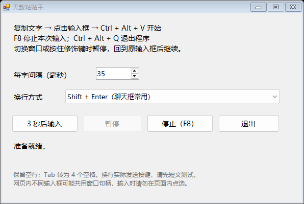

# 无敌粘贴王

超星学习通网页版的作业框提示「只能录入不能粘贴」？**无敌粘贴王**能把你复制的文字一字一字打进输入框。它是个免安装的 Windows 小工具，遇到其他网页或桌面软件禁用 `Ctrl + V` 也可以试试。

[**下载 Windows 版 InvinciblePaste.exe**](https://github.com/cookie250709/InvinciblePaste/releases/latest/download/InvinciblePaste.exe) · [查看版本和文件校验值](https://github.com/cookie250709/InvinciblePaste/releases/latest)

## 学习通不能粘贴怎么办？

1. 下载 `InvinciblePaste.exe`，双击打开。
2. 复制要填的文字，再点击学习通网页版作业的输入框。
3. 按一下 `Ctrl + Alt + V`，松开后就会开始打字。想中途停下，按 `F8`。

第一次用可以先试两行短文字。要输入长段落，可以把窗口里的「每字间隔」调小一点。

## Windows 软件禁止粘贴怎么办？

先试试把同一段文字粘到记事本。如果记事本能粘，只有目标输入框不收 `Ctrl + V`，可以用无敌粘贴王试一下。它通过 Windows 的 `SendInput` 模拟键盘打字，具体能否输入取决于目标软件是否接受模拟按键。

## 中文、换行和图片能输入吗？

可以输入中文和多行纯文本，空行也会保留。默认用 `Shift + Enter` 换行，普通多行输入框也可以在窗口里切成 `Enter`。图片、字体和排版需要用目标编辑器自己的功能处理。

## 输入到一半，想切到别的窗口怎么办？

切走会暂停，回到原窗口后会继续。在浏览器同一页里，多个输入框有时共用一个 Windows 控件，所以打字过程中别把光标点到另一个框里。想放弃剩下的文字就按 `F8`。

## 用手机看到这页，怎么下载？

这个 EXE 在 Windows 电脑上运行。可以把本页链接发到电脑上，再点上面的下载按钮。文字在本机处理。

**English** · InvinciblePaste is a portable Windows auto typer. It types clipboard text as keystrokes into an input field where paste is blocked. Press `Ctrl + Alt + V` to start and `F8` to stop.
